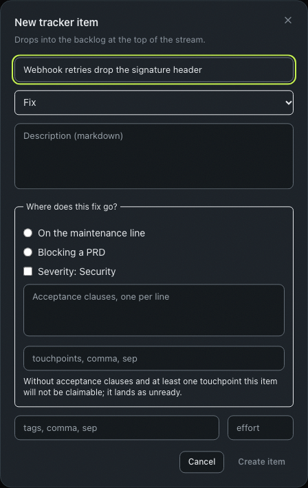
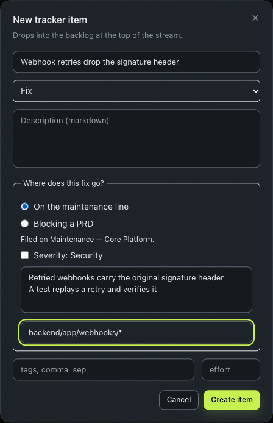
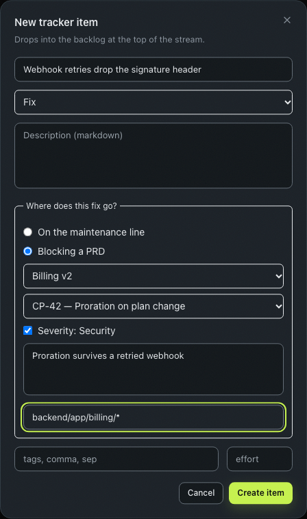
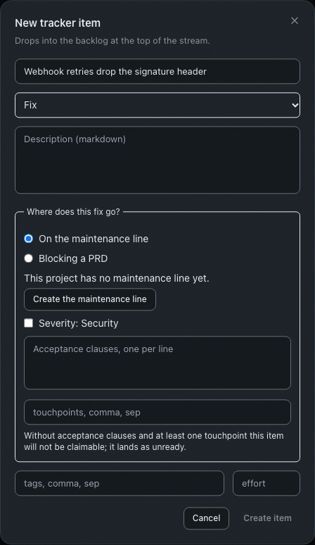
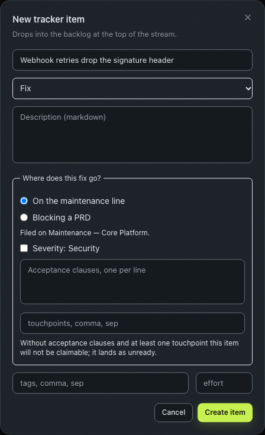
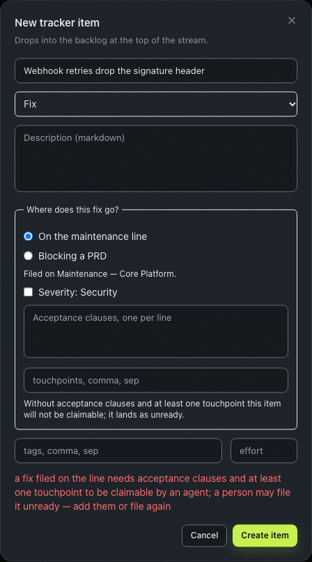

# GRPH-1699 — Fix Dialog states, as built

Design page: **Fix Dialog** in the design artifact
<https://claude.ai/artifact/3ViKQpSZw2gJD4bnHxCATb>. Each row below is one of that page's
states, rendered from the real `NewItemDialog` with the app's CSS.

To regenerate these, run `pnpm exec playwright test e2e/fix-dialog-states.play.ts --project layout`
from `web/`. The test asserts each state, then writes the PNGs to `web/test-results/`.

| Design state | As built | What the state asserts |
|---|---|---|
| Blank |  | Kind is Fix. Exactly two scopes are offered and neither is chosen. Create is disabled. |
| Line |  | Filed on the project's maintenance line, with acceptance clauses and a touchpoint. No unready notice. |
| Blocking |  | A PRD and the item it blocks are chosen. Create stays disabled until the blocked item is picked. Severity is Security. |
| No line |  | The project has no line, so "Create the maintenance line" is offered in place and Create is disabled. |
| No line → created |  | After the line is created, the dialog continues on it ("Filed on …"). |
| Line unready |  | There are no acceptance clauses and no touchpoints, so the dialog says the item will not be claimable and will land unready. |
| Refusal |  | The server's 422 `detail` is shown verbatim (`role="alert"`) and the dialog stays open. |

## Choices taken from the PRD text

The builder could not open the artifact from the build worktree, so these shots have not been
compared to it side by side. Where the page and the PRD disagree, the PRD wins. These choices
come from the PRD text:

- Severity is one checkbox, "Severity: Security", with none as the default. The PRD names only those two values.
- A person may create a fix without acceptance clauses or touchpoints. It lands unready, so the
  dialog only warns and does not block. The server's agent-side rule (GRPH-1683) is what refuses.
