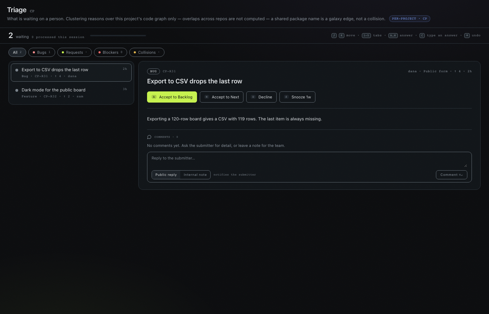
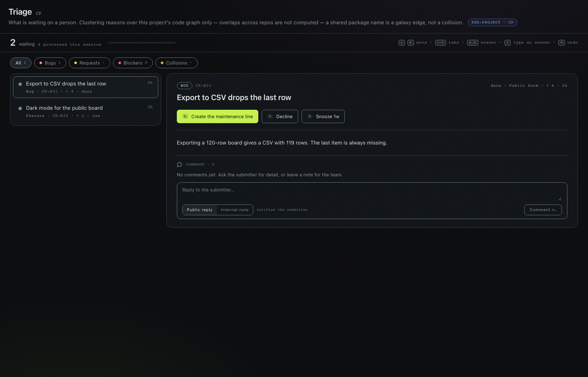
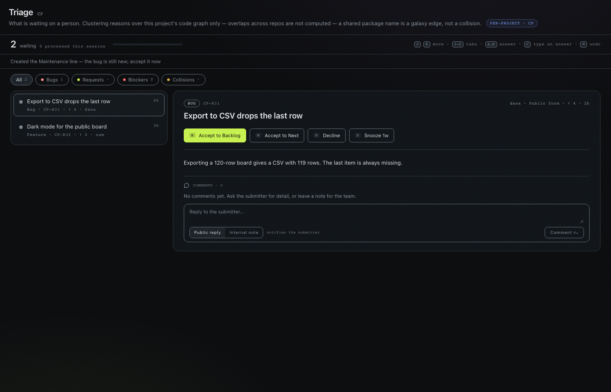
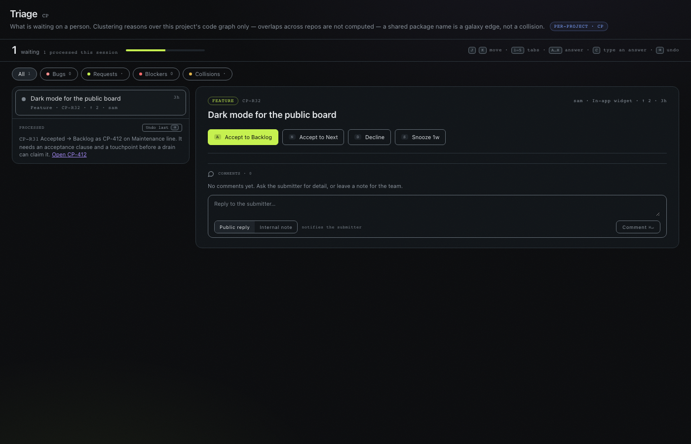

# GRPH-1700 — the triage bug pane on the maintenance line, as built

Design page: **Triage - Bug to Line** (https://claude.ai/artifact/3ViKQpSZw2gJD4bnHxCATb).
That page shows the bug pane in three states. The shots below are the same three states as
built. Each one is the real `TriageView` with the app's CSS, against a stubbed `/api`
(harness: `web/e2e/triage-bug-line/`). The agent that captured them could not open the design
page, so a person still needs to compare the two side by side.

To regenerate these, run `pnpm exec playwright test e2e/triage-bug-line.play.ts --project layout`
from `web/`. The test asserts each state, then writes the PNGs to `web/test-results/`.

| State | As built | What the state asserts |
|---|---|---|
| Line exists |  | A bug offers Accept to Backlog / Next. No PRD is offered: the "Fits PRD — will link on accept" line is gone for bugs and stays for features. |
| No line |  | "Create the maintenance line" replaces accept. The request stays `new`. |
| No line → created |  | After creating the line, the same request is still selected and still `new`, and accept is now offered. |
| Accepted and unready |  | Accept was called with no `prd_id`. The Processed line names the item on the line, says it needs an acceptance clause and a touchpoint before a drain can claim it, and links to it. |
