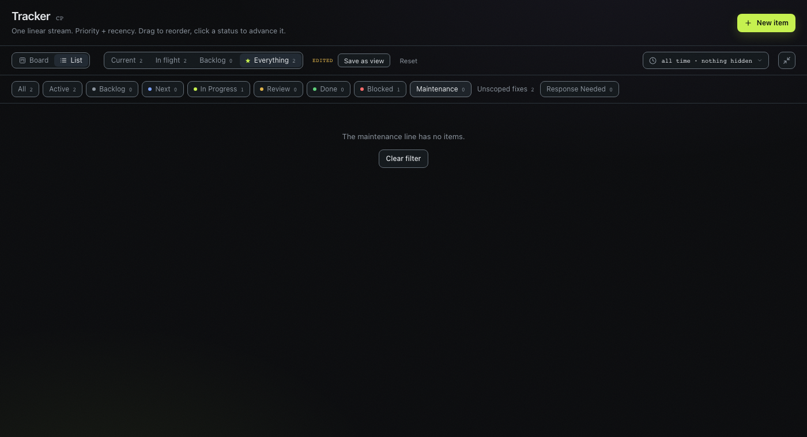
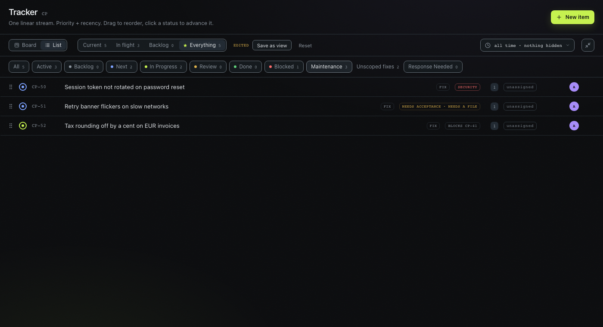
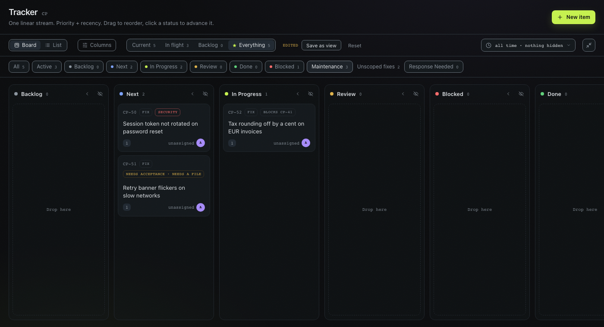
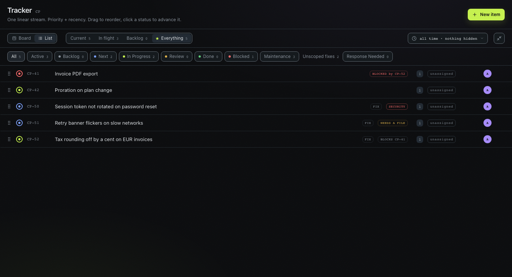

# GRPH-1701 — tracker Maintenance filter, as built

Each shot is the real `TrackerView` with the app's CSS against a stubbed `/api`
(harness: `web/e2e/tracker-maintenance/`). The project serves an unscoped-fixes count of 2.

To regenerate, run `pnpm exec playwright test e2e/tracker-maintenance.play.ts --project layout`
from `web/`. The test asserts each state, then writes the PNGs to `web/test-results/`.

Design pages (artifact https://claude.ai/artifact/3ViKQpSZw2gJD4bnHxCATb):
**Tracker - Maintenance Line** (filter, empty states, unscoped count), **Plan** (the Maintenance
chip after the status chips, row and card badges), **Tracker - File a Fix** § "After create ·
blocked by a fix" (BLOCKED label and "blocks").

| State | As built | Design page | What the state asserts |
|---|---|---|---|
| No line |  | Maintenance Line / Plan "no line" | "This project has no maintenance line." with "Create the maintenance line". The unscoped count sits beside the filter. |
| Empty line |  | Maintenance Line / Plan "empty line" | "The maintenance line has no items." — a different sentence; the no-line one is absent. |
| Populated, list |  | Plan, row badges | Only the line's three fixes. FIX on each, SECURITY on CP-50, "needs acceptance · needs a file" on CP-51, "blocks CP-41" on CP-52. No status chip is selected. |
| Populated, board |  | Plan, card badges | Same filter on the board: the columns stay, the card header wraps the badges. |
| Blocked by a fix |  | File a Fix § After create | CP-41 (status blocked, depends on fix CP-52) reads "BLOCKED by CP-52"; the fix reads "blocks CP-41". |

Note: the tracker list is lean (no descriptions), so "needs acceptance" is computed from the full
read, which is fetched only while the Maintenance filter is on. Without the filter a line item shows
"needs a file" only (shot 5, CP-51); it never claims "needs acceptance" without having read the
description.
