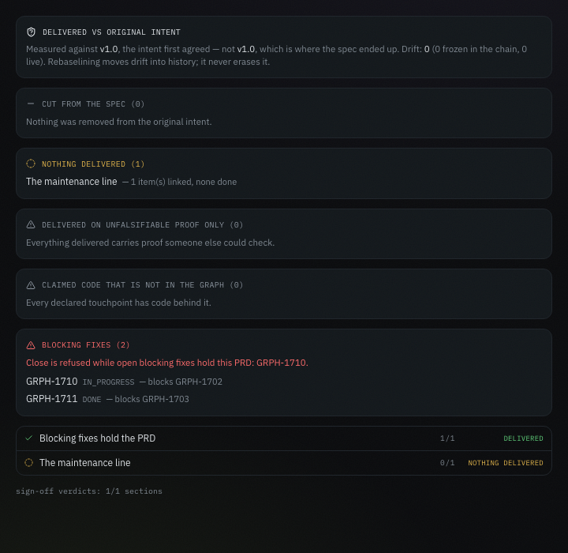
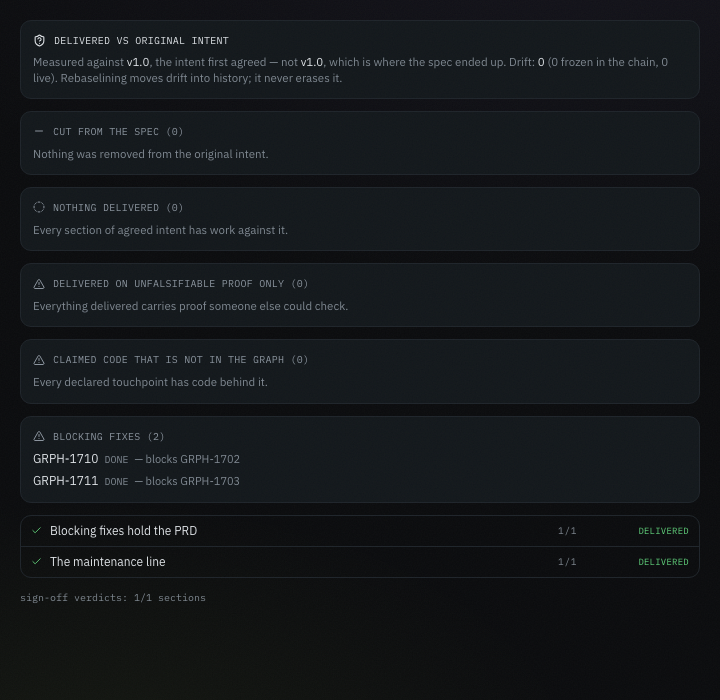
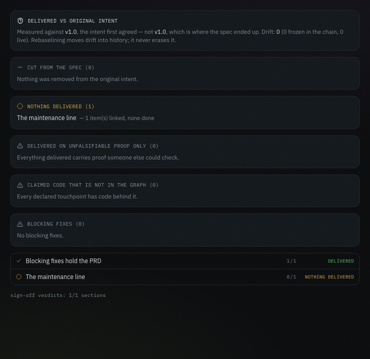

# GRPH-1702 — Acceptance tab: blocking fixes

Design page: https://claude.ai/artifact/3ViKQpSZw2gJD4bnHxCATb ("PRD - Blocking Fixes").

The real `AcceptancePanel` rendered with stubbed `/api/prds/{id}/*` responses:

| State | Screenshot |
|---|---|
| Open — one fix in progress; close refused, naming it; the done fix stays listed |  |
| All done — refusal gone, both fixes listed as done |  |
| `blocking_fixes: []` — reads "No blocking fixes." |  |

The section rows below the blocking-fixes box are unchanged by it.
