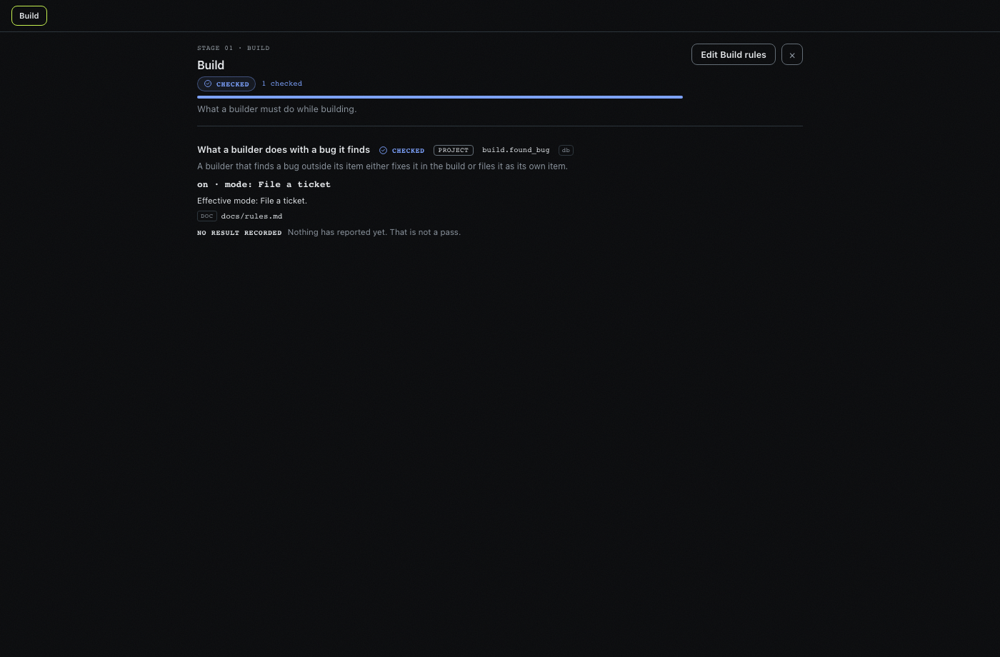
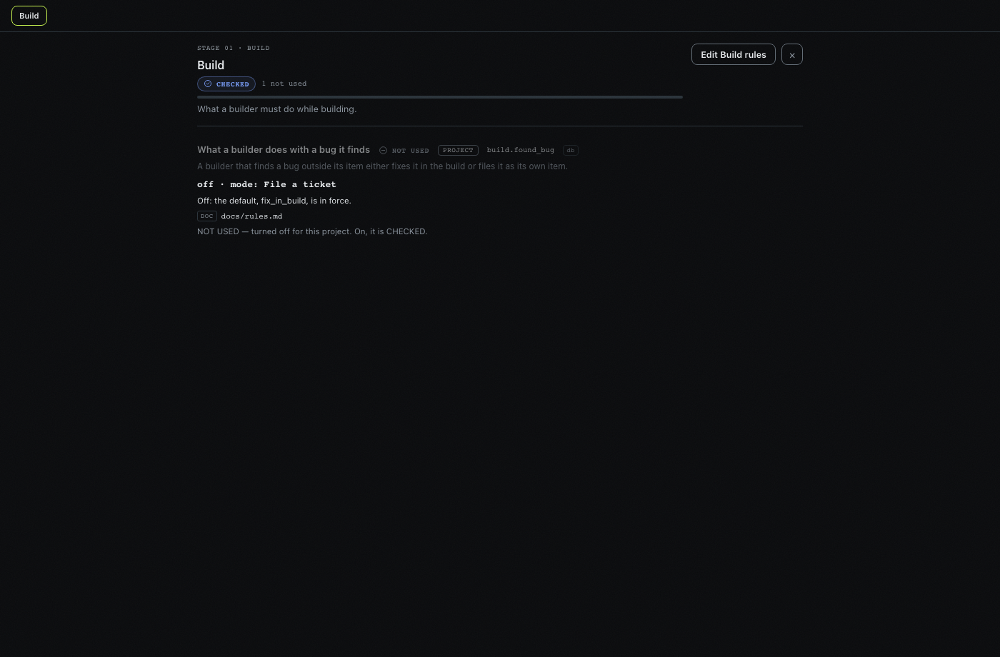
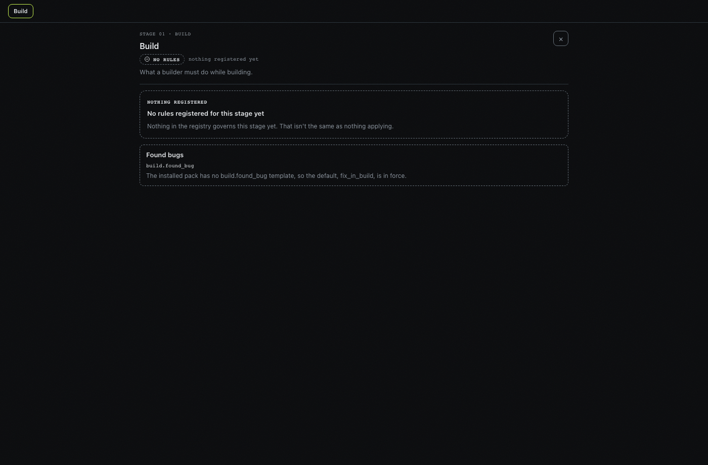
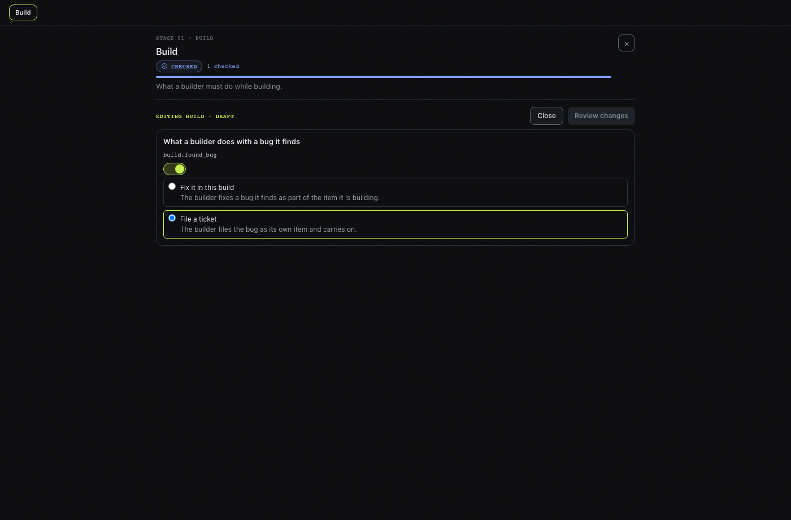

# GRPH-1703 — `build.found_bug` on the Rules page, as built

Each shot is the real `RulesView` with the app's CSS, opened on the Build stage against a
stubbed `/api` (harness: `web/e2e/rules-found-bug/`). There is no dedicated design page for
this item. It follows the existing one-setting rule pattern (`build.test_scope`).

To regenerate these, run `pnpm exec playwright test e2e/rules-found-bug.play.ts --project layout`
from `web/`. The test asserts each state, then writes the PNGs to `web/test-results/`.

| State | As built | What the state asserts |
|---|---|---|
| On |  | The rule is on in `file_ticket`, and the row reads "Effective mode: File a ticket." |
| Off |  | The toggle is off, and the row reads "Off: the default, fix_in_build, is in force." even though the stored mode is `file_ticket`. |
| Absent |  | The installed pack has no `build.found_bug` template. The Build stage shows a "Found bugs" card saying the default `fix_in_build` is in force, so the rule is not hidden. |
| Editor |  | The stage editor offers exactly two modes. Saving goes through the review sheet, which requires a reason (vitest `rules-found-bug.test.tsx`). |
